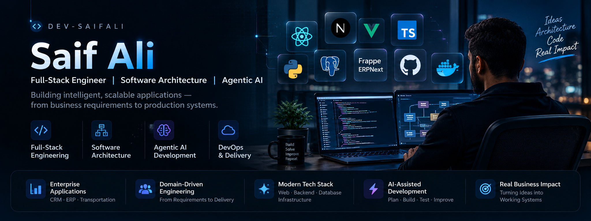

  

### Full-Stack Engineer · Software Architecture · Agentic AI

**Turning complex business requirements into scalable, production-ready software.**

---

## 👨‍💻 About Me

I'm **Saif Ali**, a full-stack engineer focused on building maintainable, scalable applications that solve real business problems.

My work combines **modern frontend engineering, backend architecture, enterprise workflows, and AI-assisted development**.

I enjoy working across the software lifecycle — understanding business requirements, designing system architecture, implementing solutions, and delivering reliable applications.

I use **AI coding agents** to accelerate development while keeping architectural decisions, code quality, and validation at the center of my engineering process.

---

## 🚀 Featured Engineering Work

### 🚚 Transportation Management System

**Enterprise Logistics | Frappe/ERPNext · Vue 3 · TypeScript**

An enterprise transportation management solution connecting commercial operations, transportation execution, and billing workflows.

**Engineering highlights:**
- Designed business workflows covering quotations, sales orders, transport jobs, trips, and billing.
- Built reusable data tables with server-side pagination, filtering, and sorting.
- Implemented frontend state management with request deduplication and race-condition protection.
- Worked on GitHub Actions CI/CD pipelines and Linux production infrastructure.

**Focus:** Enterprise workflows · Frontend architecture · Operational systems · DevOps

### 🏥 Medical Equipment Sales CRM

**Enterprise CRM | Next.js · NestJS · PostgreSQL · Clerk**

A modular CRM platform designed around medical equipment sales operations and complex business rules.

**Architecture and development focus:**
- Requirements analysis, high-level design, and low-level design.
- Modular backend architecture and relational database modeling.
- Role-based access control and record-level visibility.
- Versioned quotations and configurable approval workflows.
- Inventory, sales orders, and ERP integration architecture.

**Focus:** Domain-driven design · System architecture · Enterprise CRM · Agentic AI

> Some enterprise projects are private or under active development. Technical details are shared where permitted.

---

## 🛠️ Technologies & Tools

### Frontend Engineering

### Backend & Database

### Infrastructure & Engineering Tools

---

## 🧠 Engineering Approach

**Understand the domain → Design the system → Build incrementally → Validate → Deliver**

I believe great software engineering goes beyond choosing frameworks.

It requires understanding business rules, designing clear system boundaries, making thoughtful technical decisions, and building software that remains maintainable as requirements evolve.

**AI accelerates the workflow. Engineering judgment drives the decisions.**

---

## 🎯 Currently Exploring

- **Software Architecture** — Modular systems, database design, and scalable backend patterns.
- **Agentic AI Engineering** — AI-assisted planning, coding, review, testing, and automation.
- **Enterprise Applications** — Domain-driven workflows, CRM/ERP integration, and reliable production delivery.

---

## 🤝 Let's Connect

I'm always interested in discussing **full-stack engineering, software architecture, enterprise applications, and agentic AI**.

---

**Building systems, not just interfaces.**

